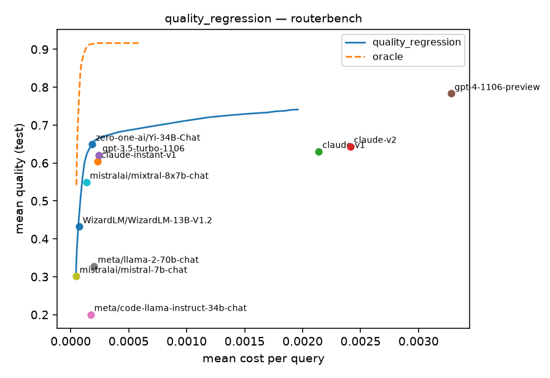

# LLM Routing — a common ground for comparing routers

Implementations of LLM **routing** papers, written to understand *what* each router does and *how*, and to compare them **fairly**: every router is trained on the same frozen data, evaluated on the same test split, with the same metrics and baselines.

> **Routing:** given a query and a pool of LLMs with different costs and abilities, decide which model answers it, so you get the best quality for the money.

**Why this repo exists.** It is a learning project: the goal is for the team to learn how to run real workloads on Sabancı's Tosun cluster, and how routers and LLM scoring actually work in code, not only in theory. So router implementations are kept **small and readable**: the paper's method is followed faithfully, but its infrastructure (own data pipelines, ablation variants, distributed training) is left out, and every deliberate deviation is written down. Each paper may also get an explanatory notebook next to its code (planned, see [CONTRIBUTING.md](CONTRIBUTING.md#keep-it-simple)).

**Working with an AI assistant?** [AGENTS.md](AGENTS.md) is the short orientation for AI coding agents (and a good map for new people too).

| paper | family | how it decides | code | explainer |
|---|---|---|---|---|
| *quality regression* (RouterBench baseline) | multi-model | predict every model's quality, pick argmax(quality − λ·cost) | [`routers/baselines.py`](llm_routing/routers/baselines.py) | [docs](docs/comparison.md) |
| *next paper…* | | | | |

## Where to start

| I want to... | read / run |
|---|---|
| understand what we are doing and why (Türkçe) | [docs/walkthrough/](docs/walkthrough/README.md): each finished project step in one write-up, with a real run. Step 1: [producing the router training data](docs/walkthrough/01_egitim_verisi.md) |
| learn routing itself | [routing fundamentals](docs/routing_fundamentals.md) → [how routers are compared](docs/comparison.md) → [benchmarks & fairness rules](docs/benchmarks.md) → [metrics](docs/evaluation.md) |
| check the code on my laptop | [Quick start](#quick-start-laptop-cpu) below: `pytest -q`, `llmr smoke-pipeline` |
| generate and score a model on Tosun | [cluster/tosun/README.md](cluster/tosun/README.md); run the 30-query pilot `configs/benchmarks/shared_pilot.yaml` first |
| add a router (paper) | [CONTRIBUTING.md](CONTRIBUTING.md) and the [router contract](docs/router_contract.md) |
| see what is decided / still open | [DECISIONS.md](DECISIONS.md) (open: cost proxy, mixed quality scales, shared accounts, GPUs for the large models, token limit for the reasoning model) |
| work on it with an AI agent | [AGENTS.md](AGENTS.md): map, commands, rules that must not break |

**Learning path:** [routing fundamentals](docs/routing_fundamentals.md) → [how routers are compared](docs/comparison.md) → [benchmarks & fairness rules](docs/benchmarks.md) → [metrics](docs/evaluation.md) → [current leaderboard](results/leaderboard.md).

## Team collection protocol

We are building the team's own version of LLM-Routing-Project. Existing routers and
benchmark configurations remain available. The new `shared-v1` pipeline adds frozen
query IDs/splits, independent member/model shards, sample-level resume/retry,
separate ground-truth, offline ArmoRM and BARTScore scoring, validated contribution bundles,
and immutable long/wide releases with hashes and per-metric benchmark views.

Start with the [team guide (Türkçe)](docs/team_workflow.md),
[technical data protocol](docs/shared_protocol.md), and
[router extension contract](docs/router_contract.md).

```bash
llmr smoke-pipeline --output /tmp/llmr-shared-smoke  # test doubles only; no models or training
```

Everything runs on Sabancı's Tosun GPUs; no paid APIs. `configs/benchmarks/shared_v1.yaml`
(GSM8K, MMLU-Pro, BBH, OlympiadBench, MBPP, Alpaca, Multi-News; k = 10) and
`configs/model_pools/team.yaml` (12 open-weight models, 3B-33B, none shared with the reference repo) are pinned to
HF commits. Ground truth uses the reference repo's audited evaluators. Planned routers:
Hybrid LLM, RouteLLM, GraphRouter, MixLLM, UniRoute, BEST-Route, PILOT, implemented by
the team on the new data (the earlier Hybrid LLM implementation was removed); the
release carries what each needs (per-sample cost, ArmoRM selector, latency), see the
router contract.

## How it fits together

```
configs/benchmarks/*.yaml ──► frozen Benchmark (queries, scores[N,M,k], costs[N,M], fixed splits, fingerprint)
                                   │            (built once on Tosun, shared via HF Hub)
configs/routers/*.yaml   ──► Router.fit(train, val) ──► Router.sweep(test) ──► quality/cost curve
configs/experiments/*.yaml         (registry)              same evaluation for every router
                                                                │
                                         runs/<benchmark>/<experiment>/<time>_s<seed>/  +  W&B
                                                                │
                                                  llmr leaderboard ──► results/leaderboard.md
```

```
llm_routing/
  core/        base.py (Router, BinaryRouter, MultiModelRouter, CascadeRouter), evaluation.py, classifiers.py
  routers/     one folder per paper + baselines.py
  data/        benchmark.py (shared format), mixinstruct / routerbench / synthetic loaders, hub.py
  pipeline/    build our own benchmark: build-queries -> generate -> score -> assemble
  runner.py    the single train+evaluate procedure;  cli.py: the `llmr` command
configs/       benchmarks/, routers/, experiments/
cluster/tosun/ SLURM setup + job scripts for Sabancı's Tosun cluster
docs/          fundamentals, comparison, benchmarks, evaluation, one explainer per paper
```

## Quick start (laptop, CPU)

```bash
python -m venv .venv && source .venv/bin/activate
pip install -r requirements.txt

llmr routers                                                    # list available routers
llmr train configs/experiments/quality_regression__synthetic.yaml    # seconds, no downloads
llmr train configs/experiments/quality_regression__routerbench.yaml  # real data (downloads RouterBench)
llmr train configs/experiments/quality_regression__synthetic.yaml seed=1 router.params.alpha=0.5   # overrides
llmr leaderboard
pytest -q
```

## On the cluster (Tosun)

See [cluster/tosun/README.md](cluster/tosun/README.md): one-time setup, then

```bash
bash cluster/tosun/submit_member.sh configs/benchmarks/shared_v1.yaml <model> <member> 4   # collect one model
bash cluster/tosun/submit_train.sh configs/experiments/<router>__shared_v1.yaml 3              # 3 seeds
```

## Adding a router or benchmark

See [CONTRIBUTING.md](CONTRIBUTING.md). In short: one folder in `llm_routing/routers/`, one YAML in `configs/routers/`, one explainer in `docs/papers/`, one row in [docs/comparison.md](docs/comparison.md).

## Results so far

Full table: [results/leaderboard.md](results/leaderboard.md). Paper routers come next, trained on `shared_v1`.



**Quality regression** on RouterBench (11 models): beats every single model except GPT-4 at a fraction of the cost, but is far below the oracle. There's a lot of room for better routers.
