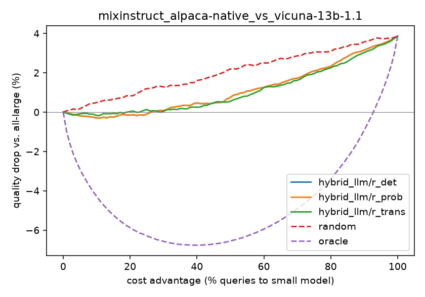

# LLM Routing — paper implementations

Implementations of LLM **routing** papers behind one common interface, written for understanding first. Every router can be trained and compared on the same data with the same metrics.

| paper | venue | type | code | notes |
|---|---|---|---|---|
| [Hybrid LLM: Cost-Efficient and Quality-Aware Query Routing](https://arxiv.org/abs/2404.14618) | ICLR 2024 | binary, pre-generation, soft-label classifier | [`routers/hybrid_llm`](llm_routing/routers/hybrid_llm/) | [explainer](docs/papers/hybrid_llm.md) |
| *next paper…* | | | | |

New to routing? Start with [docs/routing_fundamentals.md](docs/routing_fundamentals.md).

## Layout

```
llm_routing/
  core/
    base.py          Router interface: fit(), score(), route(threshold)
    types.py         RoutingDataset (queries + k quality scores per model)
    metrics.py       cost advantage, quality drop, threshold sweep, AUC
    classifiers.py   soft-label text classifiers (TF-IDF+LR on CPU, DeBERTa as in paper)
    quality.py       BARTScore
    generation.py    sample k responses from HF models
  routers/
    baselines.py     random router, oracle router
    hybrid_llm/      labels.py (r_det / r_prob / r_trans + t*), router.py
  data/              synthetic data, MixInstruct loader, JSONL io
  experiment.py      compare routers, print table, plot curves
scripts/             run_hybrid_llm.py, generate_responses.py, score_responses.py
docs/                concepts + one explainer per paper
tests/
```

## Quick start

```bash
python -m venv .venv && source .venv/bin/activate
pip install -r requirements.txt

# 1) synthetic data, CPU, seconds
python scripts/run_hybrid_llm.py --data synthetic --offset 0.3

# 2) real data: MixInstruct with precomputed BARTScores
python scripts/run_hybrid_llm.py --data mixinstruct --small alpaca-native --large vicuna-13b-1.1

# 3) paper-faithful router (DeBERTa-v3-large, GPU recommended)
pip install -r requirements-gpu.txt
python scripts/run_hybrid_llm.py --data mixinstruct --small flan-t5-xxl --large vicuna-13b-1.1 --backend deberta

# 4) full pipeline with k=10 samples per model, as in the paper
python scripts/generate_responses.py --small <hf-small> --large <hf-large> --split train --max-examples 10000 --out data/raw_train.jsonl
python scripts/score_responses.py --inp data/raw_train.jsonl --out data/train.jsonl
# (same for test) then:
python scripts/run_hybrid_llm.py --data jsonl --train data/train.jsonl --test data/test.jsonl

pytest -q
```

Each run prints a table and writes a cost/quality curve to `results/`.

## Results so far (Hybrid LLM, TF-IDF router, MixInstruct)



alpaca-native → vicuna-13b: **57% of queries go to the small model with < 1% quality drop** (random router: 22%). Details and discussion are in [docs/papers/hybrid_llm.md](docs/papers/hybrid_llm.md#7-our-results-tf-idf-router-cpu).
