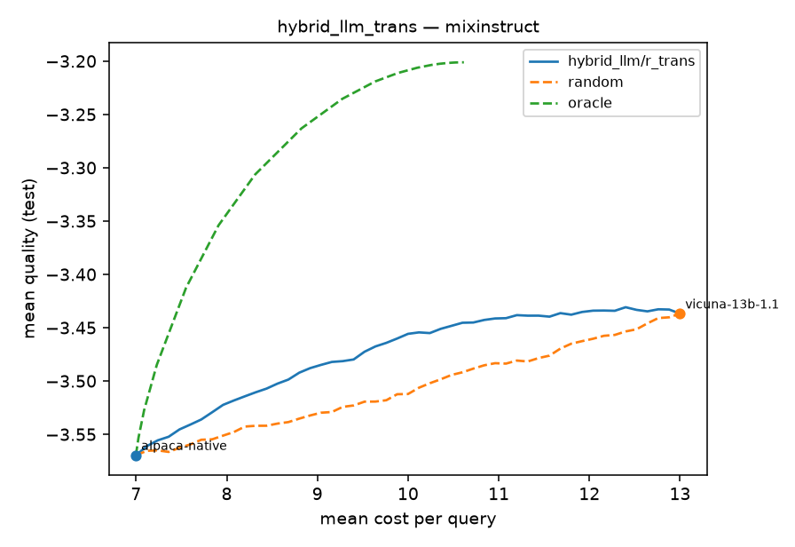

# LLM Routing — a common ground for comparing routers

Implementations of LLM **routing** papers, written to understand *what* each router does and *how*, and to compare them **fairly**: every router is trained on the same frozen data, evaluated on the same test split, with the same metrics and baselines.

> **Routing:** given a query and a pool of LLMs with different costs and abilities, decide which model answers it, so you get the best quality for the money.

| paper | family | how it decides | code | explainer |
|---|---|---|---|---|
| [Hybrid LLM](https://arxiv.org/abs/2404.14618) (ICLR 2024) | binary | classifier predicts Pr[small model is good enough], threshold | [`routers/hybrid_llm`](llm_routing/routers/hybrid_llm/) | [docs](docs/papers/hybrid_llm.md) |
| *quality regression* (RouterBench baseline) | multi-model | predict every model's quality, pick argmax(quality − λ·cost) | [`routers/baselines.py`](llm_routing/routers/baselines.py) | [docs](docs/comparison.md) |
| *next paper…* | | | | |

**Open team decisions:** [DECISIONS.md](DECISIONS.md) (LLM pool for our benchmark, cost proxy, …).

**Start here:** [routing fundamentals](docs/routing_fundamentals.md) → [how routers are compared](docs/comparison.md) → [benchmarks & fairness rules](docs/benchmarks.md) → [metrics](docs/evaluation.md) → [current leaderboard](results/leaderboard.md).

## Team collection protocol

We are building the team's own version of LLM-Routing-Project. Existing routers and
benchmark configurations remain available. The new `shared-v1` pipeline adds frozen
query IDs/splits, independent member/model shards, sample-level resume/retry,
separate ground-truth and offline ArmoRM scoring, validated contribution bundles,
and immutable long/wide releases with hashes and per-metric benchmark views.

Start with the [team guide (Türkçe)](docs/team_workflow.md),
[technical data protocol](docs/shared_protocol.md), and
[router extension contract](docs/router_contract.md).

```bash
llmr smoke-pipeline --output /tmp/llmr-shared-smoke  # test doubles only; no models or training
```

`configs/benchmarks/shared_v1.yaml` and `configs/model_pools/team.yaml` are explicit
drafts: agree the pool/cost definition and pin the `PIN_*` revisions before real
collection. RouteLLM, GraphRouter, UniRoute, BEST-Route, MixLLM and PILOT are future
paper implementations, not new routers delivered by this change.

## How it fits together

```
configs/benchmarks/*.yaml ──► frozen Benchmark (queries, scores[N,M,k], costs[N,M], fixed splits, fingerprint)
                                   │            (built once on Tosun, shared via HF Hub)
configs/routers/*.yaml   ──► Router.fit(train, val) ──► Router.sweep(test) ──► quality/cost curve
configs/experiments/*.yaml         (registry)              same evaluation for every router
                                                                │
                                         runs/<benchmark>/<experiment>/<time>_s<seed>/  +  W&B
                                                                │
                                                  llmr leaderboard ──► results/leaderboard.md
```

```
llm_routing/
  core/        base.py (Router, BinaryRouter, MultiModelRouter, CascadeRouter), evaluation.py, classifiers.py
  routers/     one folder per paper + baselines.py
  data/        benchmark.py (shared format), mixinstruct / routerbench / synthetic loaders, hub.py
  pipeline/    build our own benchmark: build-queries -> generate -> score -> assemble
  runner.py    the single train+evaluate procedure;  cli.py: the `llmr` command
configs/       benchmarks/, routers/, experiments/
cluster/tosun/ SLURM setup + job scripts for Sabancı's Tosun cluster
docs/          fundamentals, comparison, benchmarks, evaluation, one explainer per paper
```

## Quick start (laptop, CPU)

```bash
python -m venv .venv && source .venv/bin/activate
pip install -r requirements.txt

llmr routers                                                    # list available routers
llmr train configs/experiments/hybrid_llm__synthetic.yaml       # seconds, no downloads
llmr train configs/experiments/hybrid_llm__mixinstruct.yaml     # real data (downloads MixInstruct)
llmr train configs/experiments/hybrid_llm__mixinstruct.yaml router.params.mode=det seed=1   # overrides
llmr leaderboard
pytest -q
```

## On the cluster (Tosun)

See [cluster/tosun/README.md](cluster/tosun/README.md): one-time setup, then

```bash
bash cluster/tosun/submit_pipeline.sh configs/benchmarks/ours_v1.yaml --push    # build our benchmark
bash cluster/tosun/submit_train.sh configs/experiments/hybrid_llm_deberta__ours_v1.yaml 3   # 3 seeds
```

## Adding a router or benchmark

See [CONTRIBUTING.md](CONTRIBUTING.md). In short: one folder in `llm_routing/routers/`, one YAML in `configs/routers/`, one explainer in `docs/papers/`, one row in [docs/comparison.md](docs/comparison.md).

## Results so far

Full table: [results/leaderboard.md](results/leaderboard.md). TF-IDF routers on CPU; paper-faithful DeBERTa runs on Tosun are next.

| | |
|---|---|
|  |  |
| **Hybrid LLM** (alpaca-7B → vicuna-13B): 56% of queries to the small model at < 1% quality drop; matches vicuna's quality at 90% of its cost. | **Quality regression** on RouterBench (11 models): beats every single model except GPT-4 at a fraction of the cost, but is far below the oracle. There's a lot of room for better routers. |
