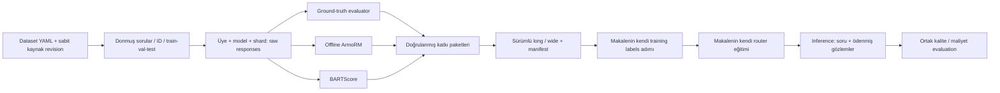

# Ortak deney veri protokolü (`shared-v1`)

Bu akış `purerepo` içindeki çalışan router ve public benchmark akışlarının üzerine
eklenir. Amaç LLM-Routing-Project'in ekipçe sürdürülen bir sürümünü geliştirmektir.
`ours_v1`, `ours_dev`, MixInstruct, RouterBench ve synthetic YAML'ları korunur.
Yeni ekip koleksiyonları `configs/benchmarks/shared_v1.yaml` ile başlar.

## Veri akışı

İlk altı adım burada uygulanır. Sonraki makalelerin label, architecture, loss,
training ve inference kodu bu çalışma kapsamında eklenmez. Quality regression
baseline'ı çalışmaya devam eder; önceki Hybrid LLM implementasyonu silindi ve yeni
veriyle baştan yazılacak.

## 1. Dataset ve kimlik

`build-queries` bütün soruları generation'dan **önce** `dataset/` içine atomik olarak
kaydeder. ID = kaynak adı + kaynak örnek kimliği/soru içeriğinin SHA256 özeti.
Satır sırası değişmesi ID'yi değiştirmez. Soru değişirse ID de değişir.

Split referans repodaki gibi iki adımda çizilir ([`splits.py`](../llm_routing/pipeline/shared/splits.py)):

1. **Neredeyse-aynı gruplar.** Bütün sorular `all-MiniLM-L6-v2` (sabit revision) ile
   vektöre çevrilir; kosinüs benzerliği ≥ 0,99 olan sorular bağlanır ve bağlı sorular tek
   grup olur. Bir grup her zaman tek bir split'e düşer, böylece bir sorunun ikizi
   train'de, kendisi test'te olamaz. `method: exact` yalnız birebir aynı metni bağlar,
   model gerektirmez (smoke testi bunu kullanır).
2. **Kaynak bazında katmanlı bölme.** Her kaynak ayrı bölünür: grupları
   `seed ^ crc32(kaynak)` ile karıştırılır ve train `floor(n·0,6)`, val `floor(n·0,7) − train`
   soruya ulaşana kadar dağıtılır; kalanı test. Her kaynak bu yüzden 60/10/30 alır (grup
   boyutları kadar sapma olabilir). `ood_datasets` içindeki kaynaklar tamamen test'e gider.

Gerçek `shared_v1` verisinde (7652 soru) 156 grup, 753 soru çıktı; 719'u BBH'den.
BBH'nin şablonlu görevleri (boolean ifadeler, parantez tamamlama, kelime sıralama)
embedding'e göre neredeyse aynı göründüğü için büyük gruplar oluşturur (en büyüğü 67
soru). Bu yüzden böyle bir görevin örnekleri toplu olarak tek split'e gider ve BBH
oranları biraz kayar (62,0 / 9,4 / 28,6). Referans repo da aynı davranışa sahiptir.
Diğer kaynaklar tam 60/10/30'dur.

`dataset_id` tüm sıralı soru kayıtlarının hash'idir. `queries.jsonl` kaynak, referans,
split ve GT evaluator adını taşır. `splits.json`, kaynak revision/fingerprint'leri,
YAML'ın çözümlenmiş hali ve dosya hash'leri manifestte saklanır. Dataset yeniden
oluşturulmaz; aynı konfigürasyonla çağrı doğrulayıp mevcut kopyayı kullanır. Farklı
konfigürasyon için yeni sürüm/path gerekir. HF kaynakları için revision zorunludur;
`shared_v1.yaml`'daki bütün kaynaklar commit SHA ile sabitlendi. Aynı normalize metin
ikinci kez gelirse (Alpaca'da var) atlanır; kaynak başına alınan/atlanan sayılar
dataset manifestine yazılır. Çok-config'li kaynaklar (`hf_config` listesi, BBH)
`n_per_config` ile görev başına eşit örneklenir.

## 2. Bağımsız generation (yalnız Tosun GPU'ları)

Ücretli/token API kullanılmaz: bütün havuz Tosun'da yerel GPU'larda çalışır. Motor
`vllm` (varsayılan) veya `hf` (vLLM bir modeli henüz desteklemiyorsa yedek). `api`
motoru kaldırıldı; config'te yazılırsa hata verir.

Havuz: [`configs/model_pools/team.yaml`](../configs/model_pools/team.yaml), referans
repodakilerden tamamen farklı 12 açık ağırlıklı model, 3B'den 33B'ye: küçük (SmolLM3 3B,
Llama 3.2 3B, Phi-4-mini), orta (Mistral 7B v0.3, OLMo 3 7B, Qwen2.5 7B, Llama 3.1 8B,
DeepSeek-R1-Distill-Llama 8B), büyük (Phi-4 15B, Mistral Small 24B, Gemma 3 27B,
Qwen2.5 32B). Llama ve Gemma gated'dir: her üye HF'de lisansı kabul etmelidir. Her model ve dataset sabit HF commit'ine
bağlıdır (2026-10-15); `PIN_*` kalmadı. `gpus: 2` olan modellerde vLLM tensor
parallelism otomatik açılır ve `submit_member.sh` iki GPU ister.

Her iş `contributions/<member>/<model>/shard-X-of-Y/` altında yazar:

- `run.json`: dataset ID, model havuzundaki tam model kaydı, generation parametreleri,
  seed, shard, üye, Git commit/dirty bilgisi ve kurulu paket sürümleri.
- `responses.jsonl`: her `(query_id, model, sample_id)` için bir satır; raw metin,
  seed, metadata, response hash, başarı/hata ve retry denemesi.
- `ground_truth.jsonl`, `armorm.jsonl`, `bartscore.jsonl`: birbirinden bağımsız skor günlükleri.

Model bazında `generation.k` global `k` değerini değiştirebilir. Üye başına değişik
soru seti üretilmez; shard'lar query ID hash'iyle ayrılır.

Seed = hash(global seed, query ID, model, sample ID). Her sample ayrı bir istek ve
kendi seed'i vardır, bu yüzden shard ve resume seed'i değiştirmez. vLLM bu istekleri
toplu gönderir (`--batch-size`, varsayılan 256; her isteğin kendi `SamplingParams(seed)`'i
var). Batch boyutu yalnız hızı etkiler, run kimliğine girmez. GPU/kernel ve
batch kompozisyonu nedeniyle aynı seed bit düzeyinde aynı sonucu garanti etmez.
Her yanıt `batch_seconds_per_sample` (batch duvar saati / batch boyutu) kaydeder:
ölçülen GPU süresi, ileride maliyet veya gecikme olarak kullanılabilir.

vLLM ve HF tokenizer'ın chat template'ini uygular; system turn ve
`chat_template_kwargs` model kaydındadır (`enable_thinking: false` referanstaki gibi).
Render edilmiş prompt, mesajlar, template metni/hash'i, tokenizer kimliği/revision
bilgisi ve prompt token ID hash'i kaydedilir. Formatlanmış chat metnine ikinci kez
özel token eklenmez. Token sayıları token ID'lerinden alınır.

`temperature`, `top_p`, `max_new_tokens`, `k` YAML'da kaydedilir: `k: 10` (best-of-n
router'ları için), `max_new_tokens: 4096` (reasoning modelleri 512'de kesilir).

Başarılı sample'lar atlanır; başarısız sample'lar batch sonunda yalnız kendileri
yeniden denenir (bounded exponential retry, her deneme saklanır). Başarısız generation
işin exit kodunu sıfırdan farklı yapar, böylece SLURM bağımlılıkları ilerlemez. Kesilmiş
son JSONL satırı `.interrupted-tail` dosyasında saklanıp yeniden yazılır; ortadaki bozuk
satır hata verir. Aynı dosya için exclusive lock vardır. SIGKILL sonrası kalan lock'u
ancak önceki işin durduğunu kontrol ettikten sonra elle kaldırın. YAML/model ayarı
veya kaynak kod hash'i değiştiğinde aynı işe resume edilmez.

## 3. Ayrı scoring kanalları (ground truth, ArmoRM, BARTScore)

**Ground truth**, referans repodaki (SU Lab LLM-Routing-Project) blind audit'lerle
sağlamlaştırılmış evaluator'ların kopyasıdır:
[`llm_routing/pipeline/ground_truth/`](../llm_routing/pipeline/ground_truth/). Her soru
`answer_type`, `gold` ve gerekirse `aux` taşır:

| kaynak | answer_type | skor |
|---|---|---|
| GSM8K | `numeric` | 0/1; "Answer: n", `\boxed{}`, "#### n", "Final Answer" başlığı, son sayı |
| MMLU-Pro | `mcq_letter` | 0/1; açık "Answer: X" sonucu, sonra son satır/prose fallback |
| BBH (27 görev × 80) | `exact_match_text` | 0/1; "Answer:" satırı, sonra göreve özgü fallback |
| OlympiadBench | `exact_match_text` + `olympiadbench` override | 0/1; sympy eşdeğerlik hakemi |
| MBPP | `code_tests` | 0/1; model kodu `python -I` alt süreçte, testlerle, zaman aşımlı |
| Alpaca, Multi-News | `reference_text` | sürekli token F1 ∈ [0, 1] |

Burada referansa göre üç düzeltme yapıldı (testleri `tests/test_ground_truth.py`):
MCQ fallback'i "A cache is…" gibi bir cümleyi artık A şıkkı saymaz (harften sonra
ayraç veya satır sonu gerekir); BBH'de altın `(B)` iken "Answer: B" doğru sayılır;
MBPP zaman aşımı scoring hatası değil yanlış cevaptır (`mode: timeout`). Sorular,
evaluator'ın ilk okuduğu biçimi ister ([`formatters.py`](../llm_routing/pipeline/shared/formatters.py)).
Gold'u olmayan kaynakta `answer_type: null` olur ve GT **null** kalır; ArmoRM bunun
yerine GT sayılmaz. MBPP model kodu çalıştırır: GT skorlamasını compute node'da yapın.

ArmoRM `RLHFlow/ArmoRM-Llama3-8B-v0.1` sabit revision ile offline yüklenir. Her soru
ve üretilmiş yanıtı user/assistant olarak kendi template'iyle değerlendirir. Scalar
score, objective rewards, gating ağırlıkları ve evaluator template hash'i saklanır.
Context aşımı sessiz truncation yerine hata olur (Multi-News bu yüzden
`max_query_chars` ile önceden süzülür; uzun örnekler kesilmez, atlanır). ArmoRM
response üretmez veya router training yapmaz. `trust_remote_code=True` sabit
revision ile kullanılır. Bu kod GPU'da henüz gerçek ArmoRM ile çalıştırılmadı; ilk
küçük Tosun koşusunda bağımlılık uyumluluğu kontrol edilmelidir.

**BARTScore**, referans repo nasıl hesaplıyorsa öyle hesaplanır (`bart_scoring_pipeline.py`):
`facebook/bart-large` (sabit revision) ile prompt verildiğinde cevabın token log-olasılıklarının
**toplamı**, yani `sum_t log p(y_t | y_<t, prompt)`. Referans cevap kullanılmaz; bütün sorular
ve bütün cevaplar skorlanır. Negatif ve sürekli; 0'a yaklaştıkça iyi. Prompt ve cevap
512 BART token'ına kesilir. Bu sınıfın sonucu, referans fonksiyonuyla gerçek `bart-large`
üzerinde birebir aynı çıktı. Dikkat: değer bir toplam olduğu için uzun cevaplar daha
düşük skor alır; `extras/completion_tokens` ile birlikte okuyun. Hybrid LLM makalesindeki
BARTScore cevabı bir referans cevaba göre puanlar; buradaki referans repo'nun tanımıdır.
Kanal, benchmark'ın `scoring:` altında `bartscore` olduğunda toplanır ve
`views/bartscore/` olarak yayımlanır.

Her scoring kaydı raw yanıtın hash'ine ve evaluator config hash'ine bağlıdır.
`text_policy: strip_think` yalnız scoring girdisinden `<think>` bloğunu çıkarır;
`raw` seçeneği aynen puanlar. Raw yanıt hiçbir zaman silinmez. Her scorer ayrı
çalıştırılır ve ayrı resume edilir. Başarısız skorlar saklanır ve yeniden denenir.

## 4. Güvenli birleştirme ve sürümleme

`package-contribution` aktif dosyalardan bağımsız, immutable bir export oluşturur.
SHA256, boyut, run ve dataset kimliği içerir. Koordinatör bu paketleri Tosun'da
birleştirir veya `contribution_paths` glob'larını verir. Paketleri taşıdıktan sonra
raw çalışma klasörlerine ihtiyaç yoktur.

Birleştirme; dosya hash'lerini, dataset/config/model kimliğini, shard üyeliğini,
seed'i, prompt'u, sample aralığını, score-response bağını ve evaluator ayarlarını
kontrol eder. Farklı üyelerden aynı anahtarlı katkılar reddedilir; `keep_last` ile
sessiz veri kaybı yapılmaz. Tek işin retry hataları audit'te kalır; canonical matrise
başarılı sample veya son başarısız kayıt girer. Varsayılan olarak eksik model,
response veya gerekli score yayını durdurur. `allow_partial: true` sadece açıkça
istenen eksik koleksiyonlara izin verir; eksiklik sayısı manifestte görünür.

`frozen/<version>/` atomik yayımlanır ve üzerine yazılmaz:

| çıktı | içerik |
|---|---|
| `long.parquet` | her response sample, raw text, ayrı GT/ArmoRM/BARTScore, token metadata JSON, seed, ayrı input/output/total cost |
| `wide.parquet` | soru başına modelin sample sayısı ve her metric için first/mean/max, toplam sample cost |
| `views/ground_truth/` | mevcut router'ların okuyabildiği GT `Benchmark` |
| `views/armorm/` | aynı sorular/modeller/split/cost ile ayrı ArmoRM `Benchmark` |
| `views/bartscore/` | aynı sorular, BARTScore (bütün sorular) |
| `views/*/extras/` | sample başına `(N, M, k)` diziler: `sample_cost`, `completion_tokens`, `seconds` ve diğer kalite kanalı (GT view'da `armorm`, ArmoRM view'da `ground_truth`) |
| `dataset/` | orijinal sorular, referanslar, split ve dataset manifesti |
| `inputs/` | katkı paketlerinin tamamı; retry/error/raw usage/scoring detayları kaybolmaz |
| `config.json`, `manifest.json` | çözümlenmiş konfigürasyon, kaynak/artifact SHA256, content hash, ortam, sürüm |

`extras` best-of-n ve gecikme duyarlı router'lar içindir: BEST-Route ArmoRM'u
selector olarak kullanıp seçtiği sample'ın GT'siyle ölçülebilir ve n sample'ın gerçek
maliyetini öder; MixLLM `seconds` ile gecikme cezası kurabilir. Diziler `(N, M, max_k)` biçimindedir; olmayan sample'lar NaN ile doldurulur. NaN
bir başarısız yanıt etiketi değildir: k sample'dan label üreten router'lar (ör. Hybrid
LLM'nin r_prob'u) padding'i paydaya katmamalıdır. Makaleye özgü label'lar frozen matrise yazılmaz.

Cost tanımı sabittir: `token_proxy` = `cost_per_1k_tokens*(input+output)/1000`, burada
`cost_per_1k_tokens` modelin parametre sayısıdır (milyar; havuzdaki bütün modeller dense). **USD diye raporlanmaz.**
API kullanılmadığı için `usd_tokens` (input/output per-million fiyat) yalnız ileride
gerekirse diye kodda durur. Tarihli snapshot, kaynak/note config'te tutulmalıdır.
Missing price ve usage hatadır; local GPU'ya sessizce sıfır fiyat atanmaz.
Single-response evaluation sample 0'ın hem kalitesini hem maliyetini kullanır.
Bütün sample maliyetleri long'da ve toplamları wide'da saklanır.

`validate-data` dosya hash'lerini, unique sample anahtarlarını, long/view score ve
cost eşitliğini, wide aggregate'lerini ve split/model sırasını kontrol eder. SHA256
aktarım bozulmasını ve yanlış eşleşmeleri tespit eder; bir üyenin üretimi gerçekten
belirttiği modelde yaptığını kriptografik olarak ispatlamaz.

## 5. Evaluation ve ilerideki router'lar

`evaluate-data` eğitim yapmadan her kalite kanalı için ayrı rapor ve kalite-maliyet grafiği üretir:
her single model, cheapest single, seeded random, quality oracle ve oracle budget
curve. Her metrikte aynı sabit complete cohort kullanılır, kullanılan query ID'leri
ve coverage raporlanır. GT ve ArmoRM cohort'ları gold bulunabilirliği nedeniyle
farklı olabilir; her kanal ayrı paneldir. Source bazında sonuçlar da yazılır.
Oracle ve hindsight best single birer evaluation referansıdır, deploy edilebilir
model seçimi veya eğitim etiketi değildir. Threshold/hiperparametre seçimi val'de
yapılmalı; test curve'ü işletim noktası seçmek için kullanılmamalıdır.

Router training mevcut runner üzerinden ayrı kalite görünümüyle yapılabilir.
Runner score/cost'u eksik soruları bütün aday modeller için tek seferde filtreler;
coverage ve query ID'lerini raporlar. `Decision` artık döndürülen sample indeksini
ve opsiyonel trace'i taşıyabilir. Total cost; generation, bütün aday sample'lar,
selector ve escalation maliyetlerini içermelidir. Best-of-N kalitesi, gerçekten
selector'ın döndürdüğü sample'dan ölçülmelidir; `max(GT)` ve `max(ArmoRM)` ayrıca
oracle üst sınırlarıdır. Online yöntemler kronolojik feedback/delayed label ve
ödenmiş gözlemler gerektirir; frozen matris tek başına tam online deney değildir.
Bu çalışma best-of-N selector veya online öğrenici implement etmez.

## Referans repodan alınan dersler

Yerel SU Lab LLM-Routing-Project'in generation/provider, ayrı GT/ArmoRM,
shared_protocol long/wide, manifest, split ve router adapter akışları incelendi.
Sample bazında JSONL, skor kanallarının ayrılması ve model-native label adapter'ı
fikri benimsendi. Ground-truth evaluator'ları ve Tosun SLURM ayarları (partition/QOS
`cuda`, `python/3.12.9` + `cuda/12.8` modülleri) referanstan alındı; prompt karışımı
(GSM8K, MMLU-Pro, BBH, OlympiadBench, MBPP, Alpaca, Multi-News) ve 60/10/30 split
referansla aynı. Referanstaki router trainer'ları kopyalanmadı. Referansta RouteLLM'in
Elo/tier hesabı val ve test battle'larını da görüyor; buradaki implementasyonda
yalnız train split kullanılmalı. Burada split'ler generation'dan önce dondurulur; model adı config
üzerinden sessizce yeniden yazılmaz; first kalite ile first maliyet eşlenir.

Backend referansları: [vLLM offline inference](https://docs.vllm.ai/en/latest/getting_started/quickstart/),
[ArmoRM model kartı](https://huggingface.co/RLHFlow/ArmoRM-Llama3-8B-v0.1).
