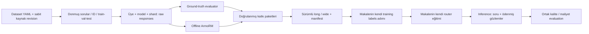

# Ortak deney veri protokolü (`shared-v1`)

Bu akış `purerepo` içindeki çalışan router ve public benchmark akışlarının üzerine
eklenir. Amaç LLM-Routing-Project'in ekipçe sürdürülen bir sürümünü geliştirmektir.
`ours_v1`, `ours_dev`, MixInstruct, RouterBench ve synthetic YAML'ları korunur.
Yeni ekip koleksiyonları `configs/benchmarks/shared_v1.yaml` ile başlar.

## Veri akışı

İlk altı adım burada uygulanır. Sonraki makalelerin label, architecture, loss,
training ve inference kodu bu çalışma kapsamında eklenmez. Mevcut Hybrid LLM ve
quality regression çalışmaya devam eder.

## 1. Dataset ve kimlik

`build-queries` bütün soruları generation'dan **önce** `dataset/` içine atomik olarak
kaydeder. ID = kaynak adı + kaynak örnek kimliği/soru içeriğinin SHA256 özeti.
Satır sırası değişmesi ID'yi değiştirmez. Soru değişirse ID de değişir. Kaynaklar
arasında normalize edilmiş aynı soru aynı split'e girer: seed + normalize soru
hash'i, YAML'daki oran aralıklarına eşlenir. Oranlar beklenen oranlardır; özellikle
küçük veri setlerinde tam oran veya her split'te örnek garantisi yoktur. Yakın anlamlı
paraphrase tespiti yapılmaz; yayın öncesi ayrıca contamination incelemesi gerekir.

`dataset_id` tüm sıralı soru kayıtlarının hash'idir. `queries.jsonl` kaynak, referans,
split ve GT evaluator adını taşır. `splits.json`, kaynak revision/fingerprint'leri,
YAML'ın çözümlenmiş hali ve dosya hash'leri manifestte saklanır. Dataset yeniden
oluşturulmaz; aynı konfigürasyonla çağrı doğrulayıp mevcut kopyayı kullanır. Farklı
konfigürasyon için yeni sürüm/path gerekir. HF kaynakları için revision zorunludur;
örnek config'teki `PIN_*` alanları gerçek çalışmadan önce commit SHA ile doldurulur.

## 2. Bağımsız generation

Her iş `contributions/<member>/<model>/shard-X-of-Y/` altında yazar:

- `run.json`: dataset ID, model havuzundaki tam model kaydı, generation parametreleri,
  seed, shard, üye, Git commit/dirty bilgisi ve kurulu paket sürümleri.
- `responses.jsonl`: her `(query_id, model, sample_id)` için bir satır; raw metin,
  seed, metadata, response hash, başarı/hata ve retry denemesi.
- `ground_truth.jsonl`, `armorm.jsonl`: birbirinden bağımsız skor günlükleri.

Model YAML'ı `model_pool` dosyasında veya benchmark'ta inline olabilir. Model bazında
`generation.k` global `k` değerini değiştirebilir. Üye başına değişik soru seti
üretilmez; shard'lar query ID hash'iyle ayrılır. Her shard ayrı dosya yazar.

Seed = hash(global seed, query ID, model, sample ID). Bir istek bir sample üretir;
böylece shard ve resume seed'i değiştirmez. Bu ilk sürüm throughput yerine açık
provenance ve güvenilir sample resume'u seçer; vLLM motoru süreçte bir kez yüklenir.
Gelecekte aynı kayıt/seed sözleşmesi korunarak batching eklenebilir. GPU/kernel,
SDK ve API servis değişiklikleri nedeniyle aynı seed bit düzeyinde aynı sonucu
garanti etmez. API seed desteği `supports_seed` ile açıkça belirtilir; gönderilmediği
zaman metadata `seed_applied: false` der.

vLLM ve HF tokenizer'ın chat template'ini uygular; system turn ve
`chat_template_kwargs` model kaydındadır. Render edilmiş prompt, mesajlar, template
metni/hash'i, tokenizer kimliği/revision bilgisi ve prompt token ID hash'i kaydedilir.
Formatlanmış chat metnine ikinci kez özel token eklenmez. HF modelinin çözümlenen
revision'ı metadata'dadır; vLLM için istenen sabit revision ve tokenizer bilgisi
saklanır. API'de servis template'i görünür değildir: gönderilen mesaj/request,
dönen model adı, varsa system fingerprint ve kullanım cevabı saklanır. API'nin
kullanmadığı seed kullanılmış gibi gösterilmez; model ismi sessizce değiştirilmez.

`temperature`, `top_p`, `max_new_tokens`, `k` YAML'da kaydedilir. API'nin farklı
parametre ihtiyaçları `api.max_tokens_field`, `send_sampling_parameters`,
`request_kwargs` ile açıkça yapılandırılır. Environment değişken **adları** config'e
girer; anahtarların değerleri kayda yazılmaz. Token sayıları HF/vLLM'de token
ID'lerinden, API'de provider usage'dan alınır. API usage yoksa maliyet uydurulmaz;
release build hata verir. `completion_tokens` provider'ın toplam billed output
sayısıdır; reasoning tokenları bir kez daha eklenmez. Ham usage ayrıntıları korunur.

Başarılı sample'lar atlanır; başarısız sample yeniden denenir. Bounded exponential
retry her başarısız denemeyi saklar. Başarısız generation işin exit kodunu sıfırdan
farklı yapar, böylece SLURM bağımlılıkları ilerlemez. Kesilmiş son JSONL satırı
`.interrupted-tail` dosyasında saklanıp yeniden yazılır; ortadaki bozuk satır hata
verir. Aynı dosya için exclusive lock vardır. SIGKILL sonrası kalan lock'u ancak
önceki işin durduğunu kontrol ettikten sonra elle kaldırın. Birden fazla süreç aynı
shard dosyasına yazmamalıdır. YAML/model ayarı veya kaynak kod hash’i değiştiğinde aynı işe resume edilmez.

## 3. İki ayrı scoring kanalı

GT, kaynağın `ground_truth_scorer` alanına göre mevcut exact-number/MCQ scorer'larını
kullanır. Checkable gold olmayan kaynakta bu alan `null` olur ve GT skoru **null**
kalır; ArmoRM bunun yerine GT sayılmaz. Başka GT scorer'ları mevcut scorer registry'ye
eklenebilir. BARTScore önceki benchmark'larda korunur; negatif BART değerleri GT
kanalına karıştırılmaz. GT'nin bu sürümü matematik/MCQ ile sınırlıdır; referans
repodaki code-execution/olympiad judge'ları taşınmamıştır.

ArmoRM `RLHFlow/ArmoRM-Llama3-8B-v0.1` sabit revision ile offline yüklenir. Her soru
ve üretilmiş yanıtı user/assistant olarak kendi template'iyle değerlendirir. Scalar
score, objective rewards, gating ağırlıkları ve evaluator template hash'i saklanır.
Context aşımı sessiz truncation yerine hata olur. ArmoRM response üretmez veya
router training yapmaz. Model kartındaki custom code için `trust_remote_code=True`
kullanılır; sabit ve incelenmiş revision seçilmelidir. Bu kodla GPU'da gerçek ArmoRM
çalıştırması yapılmamıştır; ilk küçük Tosun doğrulamasında bağımlılık uyumluluğu da
kontrol edilmelidir.

Her scoring kaydı raw yanıtın hash'ine ve evaluator config hash'ine bağlıdır.
`text_policy: strip_think` yalnız scoring girdisinden `<think>` bloğunu çıkarır;
`raw` seçeneği aynen puanlar. Raw yanıt hiçbir zaman silinmez. İki scorer ayrı
çalıştırılır ve ayrı resume edilir. Başarısız skorlar saklanır ve yeniden denenir.

## 4. Güvenli birleştirme ve sürümleme

`package-contribution` aktif dosyalardan bağımsız, immutable bir export oluşturur.
SHA256, boyut, run ve dataset kimliği içerir. Koordinatör bu paketleri Tosun'da
birleştirir veya `contribution_paths` glob'larını verir. Paketleri taşıdıktan sonra
raw çalışma klasörlerine ihtiyaç yoktur.

Birleştirme; dosya hash'lerini, dataset/config/model kimliğini, shard üyeliğini,
seed'i, prompt'u, sample aralığını, score-response bağını ve evaluator ayarlarını
kontrol eder. Farklı üyelerden aynı anahtarlı katkılar reddedilir; `keep_last` ile
sessiz veri kaybı yapılmaz. Tek işin retry hataları audit'te kalır; canonical matrise
başarılı sample veya son başarısız kayıt girer. Varsayılan olarak eksik model,
response veya gerekli score yayını durdurur. `allow_partial: true` sadece açıkça
istenen eksik koleksiyonlara izin verir; eksiklik sayısı manifestte görünür.

`frozen/<version>/` atomik yayımlanır ve üzerine yazılmaz:

| çıktı | içerik |
|---|---|
| `long.parquet` | her response sample, raw text, ayrı GT/ArmoRM, token metadata JSON, seed, ayrı input/output/total cost |
| `wide.parquet` | soru başına modelin sample sayısı ve her metric için first/mean/max, toplam sample cost |
| `views/ground_truth/` | mevcut router'ların okuyabildiği GT `Benchmark` |
| `views/armorm/` | aynı sorular/modeller/split/cost ile ayrı ArmoRM `Benchmark` |
| `dataset/` | orijinal sorular, referanslar, split ve dataset manifesti |
| `inputs/` | katkı paketlerinin tamamı; retry/error/raw usage/scoring detayları kaybolmaz |
| `config.json`, `manifest.json` | çözümlenmiş konfigürasyon, kaynak/artifact SHA256, content hash, ortam, sürüm |

Diziler `(N, M, max_k)` biçimindedir; olmayan sample'lar NaN ile doldurulur. NaN
bir başarısız yanıt etiketi değildir. Hybrid LLM'nin mevcut probabilistic label
hesabı padding'i karşılaştırma paydasına katmaz; tam veride aynı sonucu verir.
Makaleye özgü label'lar frozen matrise yazılmaz.

Cost tanımı sabittir: `usd_tokens` ayrı input/output per-million fiyatları kullanır;
`token_proxy` mevcut repo gibi `cost_per_1k_tokens*(input+output)/1000` kullanır ve
**USD diye raporlanmaz**. Tarihli snapshot, kaynak/note config'te tutulmalıdır.
Missing price ve usage hatadır; local GPU'ya sessizce sıfır fiyat atanmaz.
Single-response evaluation sample 0'ın hem kalitesini hem maliyetini kullanır.
Bütün sample maliyetleri long'da ve toplamları wide'da saklanır.

`validate-data` dosya hash'lerini, unique sample anahtarlarını, long/view score ve
cost eşitliğini, wide aggregate'lerini ve split/model sırasını kontrol eder. SHA256
aktarım bozulmasını ve yanlış eşleşmeleri tespit eder; bir üyenin üretimi gerçekten
belirttiği modelde yaptığını kriptografik olarak ispatlamaz.

## 5. Evaluation ve ilerideki router'lar

`evaluate-data` eğitim yapmadan iki ayrı rapor ve kalite-maliyet grafiği üretir:
her single model, cheapest single, seeded random, quality oracle ve oracle budget
curve. Her metrikte aynı sabit complete cohort kullanılır, kullanılan query ID'leri
ve coverage raporlanır. GT ve ArmoRM cohort'ları gold bulunabilirliği nedeniyle
farklı olabilir; sonuçlar iki ayrı paneldir. Source bazında sonuçlar da yazılır.
Oracle ve hindsight best single birer evaluation referansıdır, deploy edilebilir
model seçimi veya eğitim etiketi değildir. Threshold/hiperparametre seçimi val'de
yapılmalı; test curve'ü işletim noktası seçmek için kullanılmamalıdır.

Router training mevcut runner üzerinden ayrı kalite görünümüyle yapılabilir.
Runner score/cost'u eksik soruları bütün aday modeller için tek seferde filtreler;
coverage ve query ID'lerini raporlar. `Decision` artık döndürülen sample indeksini
ve opsiyonel trace'i taşıyabilir. Total cost; generation, bütün aday sample'lar,
selector ve escalation maliyetlerini içermelidir. Best-of-N kalitesi, gerçekten
selector'ın döndürdüğü sample'dan ölçülmelidir; `max(GT)` ve `max(ArmoRM)` ayrıca
oracle üst sınırlarıdır. Online yöntemler kronolojik feedback/delayed label ve
ödenmiş gözlemler gerektirir; frozen matris tek başına tam online deney değildir.
Bu çalışma best-of-N selector veya online öğrenici implement etmez.

## Referans repodan alınan dersler

Yerel SU Lab LLM-Routing-Project'in generation/provider, ayrı GT/ArmoRM,
shared_protocol long/wide, manifest, split ve router adapter akışları incelendi.
Sample bazında JSONL, skor kanallarının ayrılması ve model-native label adapter'ı
fikri benimsendi. Referanstaki router trainer'ları veya büyük prompt dosyaları
kopyalanmadı. Burada split'ler generation'dan önce dondurulur; model adı config
üzerinden sessizce yeniden yazılmaz; first kalite ile first maliyet eşlenir.

Backend referansları: [vLLM offline inference](https://docs.vllm.ai/en/latest/getting_started/quickstart/),
[ArmoRM model kartı](https://huggingface.co/RLHFlow/ArmoRM-Llama3-8B-v0.1).
